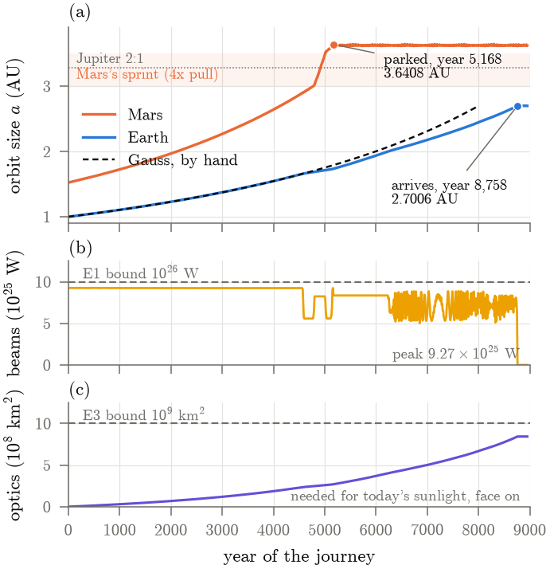
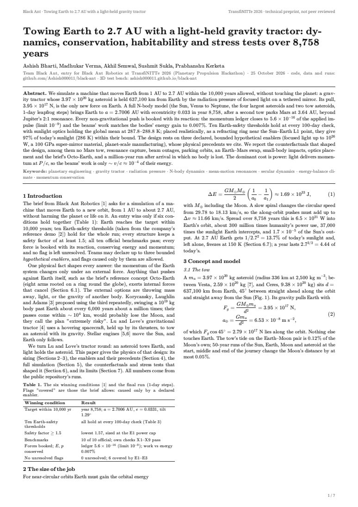
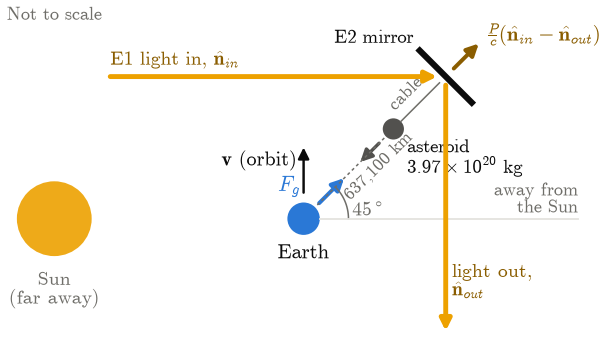
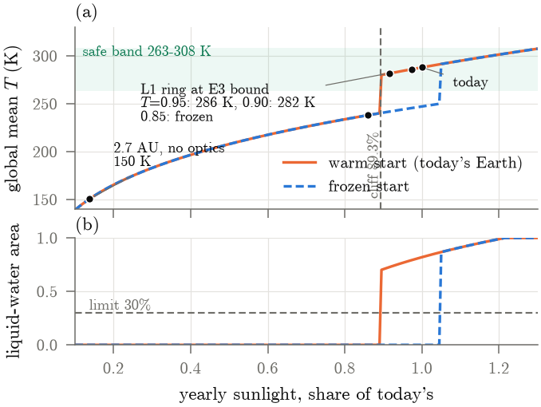
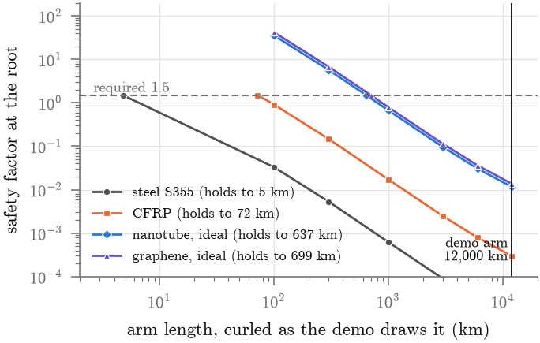
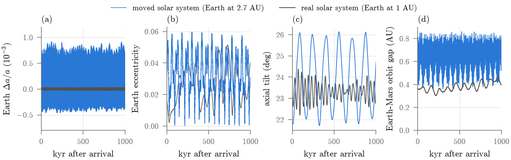
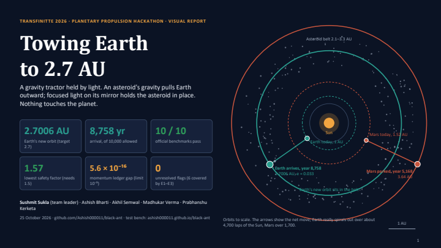
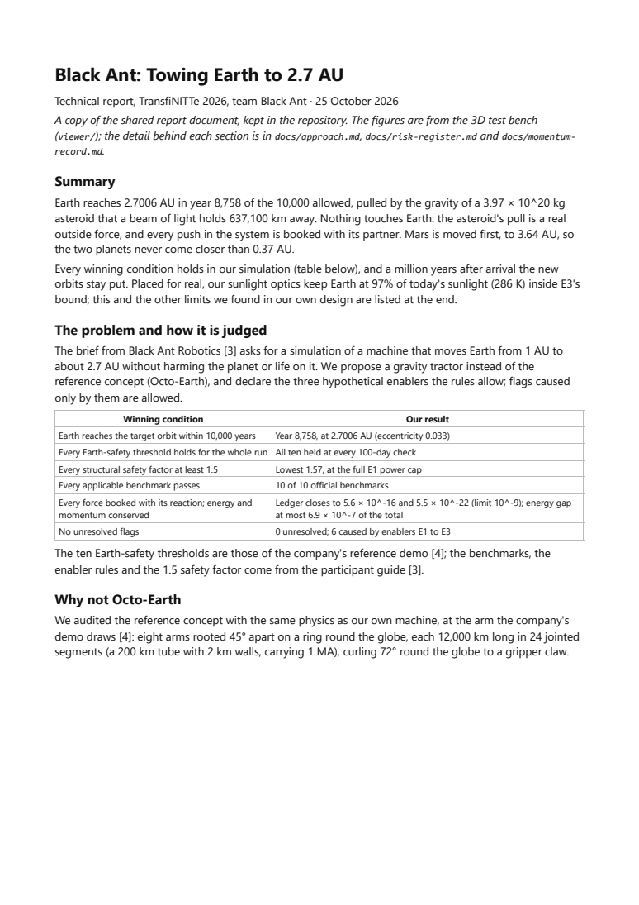

<h1 align="center">Black Ant: towing Earth to 2.7 AU</h1>

<p align="center"><b>A gravity tractor held by light.</b> An asteroid's gravity pulls Earth outward; focused light on a mirror tied to the asteroid holds it in place. Nothing touches the planet.<br>
Team Black Ant's entry for <b>Black Ant Robotics</b> at TransfiNITTe 2026: a simulation that moves Earth from 1 AU to 2.7 AU without harming the planet or life on it.</p>

<p align="center">
<a href="https://github.com/Ashish000011/black-ant/actions/workflows/tests.yml"></a>
<a href="https://ashish000011.github.io/black-ant/"></a>


</p>

<p align="center"><a href="docs/physics/black-ant-physics-paper.pdf"></a></p>
<p align="center"><sub><b>The journey.</b> (a) Mars is towed out first and parked at 3.64 AU in year 5,168, sprinting across Jupiter's 2:1 resonance; Earth follows Gauss's spiral and arrives at 2.7006 AU in year 8,758 of the 10,000 allowed. (b) Both beams stay under E1's 10²⁶ W. (c) The sunlight optics stay under E3's 10⁹ km². Figure 2 of the physics paper, drawn from <code>results/</code>.</sub></p>

<table align="center">
<tr>
<td align="center"><b>2.7006 AU</b><br><sub>Earth's new orbit<br>(target 2.7)</sub></td>
<td align="center"><b>Year 8,758</b><br><sub>arrival, of<br>10,000 allowed</sub></td>
<td align="center"><b>10 / 10</b><br><sub>official benchmarks,<br>inputs changeable</sub></td>
<td align="center"><b>32,686</b><br><sub>100-day safety checks,<br>all ten thresholds held</sub></td>
<td align="center"><b>1.57</b><br><sub>lowest safety factor<br>(needs 1.5)</sub></td>
<td align="center"><b>5.6 × 10⁻¹⁶</b><br><sub>momentum ledger gap<br>(limit 10⁻⁹)</sub></td>
<td align="center"><b>0</b><br><sub>unresolved flags<br>(6 covered by E1–E3)</sub></td>
<td align="center"><b>1,000,000 yr</b><br><sub>after arrival: orbits hold,<br>the Moon stays</sub></td>
</tr>
</table>

## The physics paper

<table>
<tr>
<td width="230" valign="top"><a href="docs/physics/black-ant-physics-paper.pdf"></a></td>
<td valign="top">

**[Towing Earth to 2.7 AU with a light-held gravity tractor: dynamics, conservation, habitability and stress tests over 8,758 years](docs/physics/black-ant-physics-paper.pdf)** (PDF, 7 pages)

Ashish Bharti, Madhukar Verma, Akhil Semwal, Sushmit Sukla, Prabhanshu Kerketa · Team Black Ant · 25 October 2026 · technical preprint

The whole physics of the machine in one journal-style paper, every number drawn from `results/` and `config.yaml`: **10 figures, 6 tables, 9 numbered equations, 50 references.**

- **The tow:** the asteroid's pull and why it sits at 45°; the light pressure (P/c)(n̂ᵢₙ − n̂ₒᵤₜ) and the power it costs; the hover instability and the controller that beats it.
- **The spiral by hand:** Gauss's equations give 8,004 years against the simulated 8,758.
- **The model:** the N-body engine and the error-free momentum ledger; the Budyko–Sellers climate with ice-albedo feedback and the ten Earth-safety models; the structures at the power cap.
- **The enablers E1–E3:** the guide's allowed kind, the bound, the most the run used, the flags each covers, and the real-world precedents (IKAROS, LightSail 2, Starshot, DE-STAR).
- **Every stress test:** Octo-Earth audited, no Mars tow, Jupiter's 2:1 crossing, Mars parking, beam outages, the Earth–Mars swap, the climate cliff and the L1 ring, small bodies, the tow mirror at night, and a million years after arrival.

A companion to the submitted [technical report](docs/black-ant-report.pdf), not a replacement. Rebuilt by the scripts in [`docs/physics/`](docs/physics/) after any new run; the clickable [physics deck](docs/physics/black-ant-physics-deck.pptx) (11 slides, 5 hidden backups, speaker notes) presents it in 7–8 minutes.

</td>
</tr>
</table>

<table>
<tr>
<td width="50%" align="center"><a href="docs/physics/black-ant-physics-paper.pdf"></a><br><sub><b>Fig. 1</b> The tow: light in along n̂ᵢₙ, out along n̂ₒᵤₜ; the asteroid 637,100 km from Earth at 45° between the orbit and the anti-Sun direction</sub></td>
<td width="50%" align="center"><a href="docs/physics/black-ant-physics-paper.pdf"></a><br><sub><b>Fig. 5</b> The climate cliff at 89.3% of today's sunlight: without optics Earth freezes at 150 K; the L1 ring at E3's bound keeps 286 K</sub></td>
</tr>
<tr>
<td align="center"><a href="docs/physics/black-ant-physics-paper.pdf"></a><br><sub><b>Fig. 8</b> Octo-Earth audited: the safety factor at an arm's root against its length, four materials; the 12,000 km arm as drawn is at 0.012</sub></td>
<td align="center"><a href="docs/physics/black-ant-physics-paper.pdf"></a><br><sub><b>Fig. 9</b> A million years after arrival, the moved solar system beside the real one: orbit size, eccentricity, axial tilt and the Earth–Mars gap</sub></td>
</tr>
</table>

## What to read, in order

<table>
<tr>
<td width="33%" align="center" valign="top"><a href="docs/physics/black-ant-physics-paper.pdf"></a><br><b><a href="docs/physics/black-ant-physics-paper.pdf">Physics paper</a></b><br><sub>7 pages · every model, enabler and stress test · 50 references</sub></td>
<td width="33%" align="center" valign="top"><a href="docs/black-ant-visual-report.pdf"></a><br><b><a href="docs/black-ant-visual-report.pdf">Visual report</a></b> (<a href="docs/black-ant-visual-report.pptx">.pptx</a>)<br><sub>11 dense slides · native diagrams and charts · speaker notes</sub></td>
<td width="33%" align="center" valign="top"><a href="docs/black-ant-report.pdf"></a><br><b><a href="docs/black-ant-report.pdf">Technical report</a></b> (<a href="docs/report.md">source</a>)<br><sub>8 pages, as submitted · 43 references</sub></td>
</tr>
</table>

| | |
| --- | --- |
| **[3D test bench](https://ashish000011.github.io/black-ant/)** (live) | The journey in 3D with every check beside it: forces, orbit, structures, the ten thresholds, benchmarks, plots, a million years. Replays `results/`; a scale bar in every view |
| **[Demo video](media/black-ant-demo.mp4)** (2 min 20 s) · **[Explainer video](media/black-ant-explainer.mp4)** | The journey shot in the test bench; the physics rules one scene at a time, with [captions](media/black-ant-explainer.srt) |
| **Check it yourself:** `run.bat verify` | Re-runs the benchmarks, the tests, the engine and the studies and writes one results PDF in about 4 minutes ([details](#test)) |
| [Where we are](docs/status.md) · [the brief](docs/problem.md) · [the approach](docs/approach.md) · [enablers](docs/enablers.md) · [risk register](docs/risk-register.md) · [Q&A](docs/qa.md) · [momentum record](docs/momentum-record.md) | The documents behind the numbers |

## The six winning conditions

| Condition (participant guide) | Our result |
| --- | --- |
| Earth reaches the target orbit within 10,000 years | Year 8,758, at 2.7006 AU (eccentricity 0.033) |
| Every Earth-safety threshold holds for the whole run | All ten held at every one of 32,686 100-day checks |
| Every structural safety factor at least 1.5 | Lowest 1.57, cables and anchors at the full E1 power cap |
| Every applicable benchmark passes | 10 of 10 official benchmarks, also with changed inputs; our checks X1–X9; 49 tests on every pull request |
| Every force booked with its reaction; energy and momentum conserved | Ledger closes to 5.6 × 10⁻¹⁶ and 5.5 × 10⁻²² of the applied impulse (limit 10⁻⁹); beam work matches energy gained to 0.007% |
| No unresolved flags | 0 unresolved; 6 raised, each covered by a declared enabler (E1, E2 or E3) |

**Team Black Ant:** Sushmit Sukla (team leader), Ashish Bharti, Akhil Semwal, Madhukar Verma, Prabhanshu Kerketa. Who built what is in [docs/contributions.md](docs/contributions.md).

## Our approach in short

A **gravity tractor held in place by light**. A 4 x 10^20 kg asteroid sits 637,100 km from Earth and
pulls it gently with its own gravity; a focused light beam pushing on a mirror tethered to the asteroid
keeps it from falling onto Earth. Earth's orbit widens a little on every lap and reaches 2.7 AU in about
8,760 years. Mars is towed out of the way first (to 3.64 AU), sunlight mirrors keep Earth at today's
sunlight and temperature, and on the last stretch the tow steers Earth onto the orbit Jupiter lets it
keep. Every push is booked with its reaction, so energy and momentum are checked all the way.

Read [docs/approach.md](docs/approach.md) for the full plan, the physics and why Octo-Earth cannot work,
and [docs/risk-register.md](docs/risk-register.md) for every way it could fail and what we did about it.

## Results

<!-- results:start -->
| | |
| --- | --- |
| Earth arrives | year 8,758 at 2.7006 AU (limit: year 10,000); eccentricity 0.0331, orbit tilt 1.294 deg |
| Mars parks | year 5,168 at 3.6408 AU |
| Closest Earth-Mars pass | 0.37283 AU (limit 0.05) |
| Closest big asteroid during the journey | ceres 0.0455 AU, pallas 0.0681 AU, vesta 0.0183 AU, hygiea 0.1633 AU (limit 0.02) |
| Most beam power | 9.27e+25 W (E1 limit 1e26) |
| Ledger (the guide's form) | bodies' momentum change matches the applied impulse to 5.5e-22 of it; applied impulse plus its partners: 5.6e-16 (limit 1e-9); beam work matches energy gained to 0.007% |
| Flags during the journey | 0 unresolved; 6 covered by E1, E2, E3 |
| Earth safety: the ten thresholds of the company's reference demo, worst over the journey | temperature 287.8 to 288.8 K (263 to 308); liquid-water area at least 82% (30%); absorbed sunlight at most 241 W/m2 (282); surface pressure 101.3 kPa (50); N2 Jeans lambda at least 194 (30); magnetopause at least 10.0 Earth radii (3); day length changed by under 1e-6 s (1 s); the Moon at most 0.26 of the Hill radius (0.49); thrust at most 0.0020 of Earth's pull on the Moon (0.01) |
| Sunlight mirrors (E3) | sunlight 0.995 to 1.010 of today's; mirrors up to 8.5e+08 km2 (limit 1e9) |
| Asteroid impacts (1 km and up), without E1's nudges | one per 127 years crossing the belt, one per 87 years parked; natural: one per 500,000 |
| A million years after arrival: Earth | orbit 2.698 to 2.702 AU; eccentricity up to 0.060 (real Earth: up to 0.051) |
| A million years after arrival: Mars | orbit 3.614 to 3.655 AU; smallest gap to Earth's orbit 0.362 AU |
| Earth's axial tilt | 21.7 to 26.1 deg (real Earth: 22.2 to 24.4) |
| Sunlight the mirrors re-aim to keep today's seasons | 1.4% of Earth's sunlight (mirrors supply 86%) |
| Big-asteroid passes near Earth | 45 in a million years; each nudged with at most 0.6 hours of a 1e+25 W beam, 50 years ahead |
| Flags after a million years | 0 unresolved; 2 covered by enablers |
| Bodies thrown out in a million years | none |
<!-- results:end -->

Every number above comes from `results/`. The run prints any flag at the end; a flag naming E1, E2 or E3
relies on one of our declared enablers, which the brief allows.

## The 3D test bench

**[ashish000011.github.io/black-ant](https://ashish000011.github.io/black-ant/)**: the journey in 3D (the solar system,
the Earth tow and the Mars tow up close, and a top-down view with every orbit as a circle), ten experiments from the
baseline to a million years later, and every check beside it: forces and momentum, orbit, structures, the ten
Earth-safety thresholds, benchmarks, plots and the comparison with the real solar system. Laid out like Blender: a
Scene tab with where every body is (click the Moon or a tow asteroid to see it up close), a Model panel with the
experiments, time meters and the concept and enablers, and a Data panel with the constants, Earth at the start and
Earth now. It replays the model's saved runs; only the Moon reflectors (marked ≈, `sim/night.py`) are not in the run.
Keys: Space plays, T and N hide the panels, 7 toggles the top view; A− and A+ in the top bar change the text size.

```bash
uv run python -m sim.viewer_data   # turn results/ into viewer/public/data/
cd viewer && npm ci && npm run dev # open the address it prints
```

It is published from `main` by `.github/workflows/pages.yml`.

## Setup

**On Windows, double-click `run.bat`**: a menu to set up, open the 3D test bench, run the benchmarks and tests,
check everything into one results PDF, build the report PDF and run the journey (or `run.bat setup`, `run.bat bench`,
`run.bat verify`, `run.bat pdf` and so on).

Otherwise you need [uv](https://docs.astral.sh/uv/) (and Node.js for the test bench). From this folder:

```bash
uv python install 3.12
uv sync
```

## Run

```bash
uv run python -m sim.scenarios.tow --out results    # the full journey with every check, about an hour and a half
uv run python -m sim.scenarios.tow --no-belt --years 500   # a quick look
uv run python -m sim.scenarios.moon                 # the Moon test at the start, middle and end, about 20 seconds
uv run python -m sim.scenarios.longterm --only moved --state results/end_state.json --out results/longterm.json
                                                    # a million years after arrival, about 15 minutes
uv run python -m sim.scenarios.parking              # where Earth and Mars can park, a million years each
uv run python -m sim.scenarios.outage               # how long a beam can fail before its asteroid is lost
uv run python -m sim.scenarios.octo                 # the Octo-Earth audit: net force, arm stress and buckling, 10 seconds
uv run python -m sim.scenarios.small_asteroids      # rocks under 1 km at 2.7 AU: impacts, survey, E1, wear, a second
uv run python -m sim.scenarios.swap                 # Plan S: tow Mars in instead of out; the Earth-Mars crossing, a few minutes
                                                    # (--longterm 1e6 for the swapped orbits' million years, --handover 3000)
```

Add `--no-mars-tow` to the journey to see why Mars must move first, or `--orbits circular` for flat
circular starting orbits.

## Test

```bash
uv run python -m sim.benchmarks    # the ten official benchmarks, measured against expected, about 12 seconds
uv run python -m sim.benchmarks 4 --set e=0.5 --set periods=20   # change a benchmark's inputs, as judges may
uv run pytest -m "not slow" -v     # quick tests, about a minute (these run on every pull request)
uv run pytest -v -s                # everything, a few minutes
uv run python scripts/verify.py    # check everything into one PDF, about 5 minutes (--full adds the slow tests)
```

`scripts/verify.py` (or `run.bat verify`) runs the benchmarks, the tests, a fresh 200-year run of the engine
compared with the official run (same orbits, ledger closed, every safety threshold held), the Moon test, the
Octo-Earth audit and the two studies re-run against `results/`, and the six winning conditions, and writes
`out/verify/black-ant-verification.pdf`. It exits 1 if anything fails.

The official benchmarks (participant guide, section 6) are `tests/test_official_benchmarks.py`; our own extra
checks are X1 to X9 in `tests/test_extra_checks.py` and `tests/test_checks.py`.

## How we work

- **Nobody pushes to `main`.** Make a branch for your issue (`m2/safety-report`), push it, and open a
  pull request. Ashish reviews and merges; the quick tests must pass first.
- **Your tasks are GitHub issues.** Who did what is in [docs/contributions.md](docs/contributions.md).
- **Rules live in `config.yaml`.** Every limit has its source next to it. If the organisers change a rule,
  change the number there and ask for a re-run; don't hard-code numbers anywhere else.
- **Numbers on slides come from `results/`**, never from memory.

## Where things are

| Path | What it holds |
| --- | --- |
| `CONTEXT.md` | The whole project in one file for AI assistants and new teammates: state, decisions, important prompts, log |
| `docs/problem.md` | The brief and the winning conditions |
| `docs/enablers.md` | Our three hypothetical enablers, as declared at the mid-point check-in |
| `docs/approach.md` | Our plan, the physics, the machine, what we found and fixed |
| `docs/status.md` | Where we are: every deliverable and issue, and what is left |
| `deck/`, `docs/black-ant-visual-report.pptx` | The visual report: 11 dense slides whose diagrams are native PowerPoint shapes and charts, every number read from `results/` (`uv run python deck/data.py && node deck/build.mjs`; `deck/export.ps1` prints the PDF with PowerPoint) |
| `docs/report.md` | The technical report (a copy of the shared document), with figures in `docs/img/`; `docs/black-ant-report.pdf` is it as submitted (8 pages, built by `run.bat pdf`) |
| `docs/physics/` | The physics paper (PDF, 7 pages) and the clickable physics deck (.pptx), both built from `results/` by the scripts beside them |
| `docs/qa.md`, `docs/rules.md` | Answers for the judges' questions; the guide's rules and where each is met |
| `docs/contributions.md` | Who built what: each member's own lines, for the careers offers |
| `docs/risk-register.md` | Every risk: why it matters, how we check it, the counter, its status, its owner |
| `media/` | The demo video, and the explainer video (the physics rules, one scene each) with its captions |
| `run.bat`, `scripts/` | The Windows menu for setting up and running everything; `scripts/verify.py` checks everything into one results PDF; `scripts/report_pdf.py` builds the report PDF |
| `config.yaml` | Every setting and working rule, with sources; change a number and re-run |
| `results/` | The final run: `summary.json` (every number and flag), `run.json` (one frame per 10 years, what the viewer plays), `end_state.json`, `longterm.json`, `outage.json`, `parking*.json` |
| `sim/bodies.py` | Bodies and their real starting orbits |
| `sim/integrator.py` | Gravity, the leapfrog and Yoshida fourth-order steppers, exactly opposite pair forces, energy |
| `sim/forces.py` | Each tow's spot, and the beam that holds its asteroid there |
| `sim/ledger.py` | The force ledger, kept exactly: applied impulse, station recoil, bounced light, asteroids sent away |
| `sim/flags.py` | Checks and flags |
| `sim/benchmarks.py` | The ten official benchmarks, each with inputs that can be changed |
| `sim/habitability.py` | Sunlight, the sunlight mirrors' build schedule, temperature, shielding, the Moon's Hill sphere |
| `sim/night.py` | Night light after the move: moonlight, and Moon reflectors (light and heat), for the test bench's estimates |
| `sim/em.py` | Lorentz force and Biot-Savart fields (benchmarks 1 to 3, and the Octo-Earth audit) |
| `sim/checks/` | Earth-safety and structure checks, run every 100 days |
| `sim/belt.py` | 1,000 test asteroids on real orbits: close passes and the impact estimate |
| `sim/secular.py` | The arrival trim: steering Earth's orbit shape and plane |
| `sim/spin.py` | Earth's spin axis, axial tilt and seasons |
| `sim/scenarios/` | The journey, the Moon test, the million-year run, the parking scan, the outage test, the Plan S Earth-Mars swap study (`swap.py`) |
| `sim/viewer_data.py` | Turns `results/` into the 3D test bench's data files |
| `viewer/` | The 3D test bench (Vite and Three.js), published on GitHub Pages |
| `tests/` | The ten official benchmarks, our extra checks X1 to X9 and the safety and structure checks |
| `data/` | Raw JPL data: Horizons vectors and Small-Body Database orbits |
| `sim-proto/` | The first JavaScript prototype, kept for quick experiments |

## Model limits

Planets Venus to Neptune start on their real tilted, oval orbits at J2000.0 (1 January 2000, noon),
from JPL's [orbital elements](https://ssd.jpl.nasa.gov/planets/approx_pos.html); Ceres, Pallas, Vesta
and Hygiea from JPL Horizons. No Mercury (its pull on Earth is tiny and it would need much shorter steps).
Earth carries the Moon's mass in the long runs; the Moon test follows the Moon itself. The benchmarks,
enabler rules and the 1.5 safety factor come from the participant guide; the ten Earth-safety thresholds
from the company's reference demo, until the rulebook appendix says otherwise.
