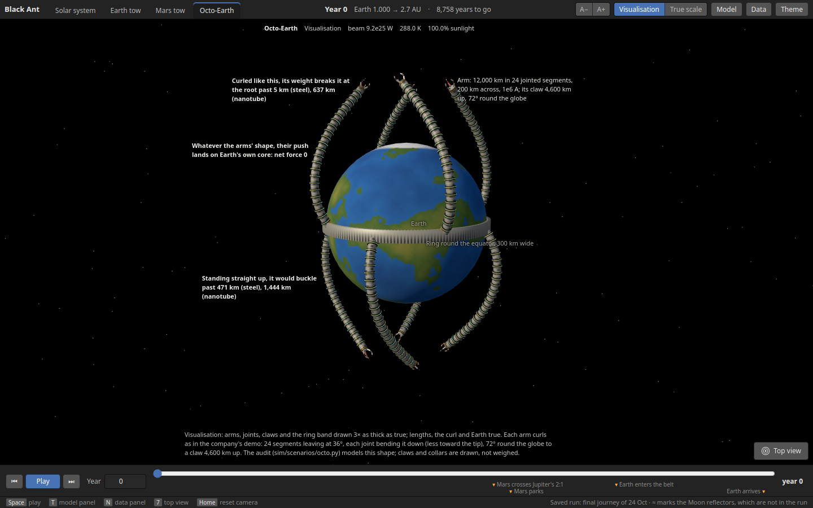
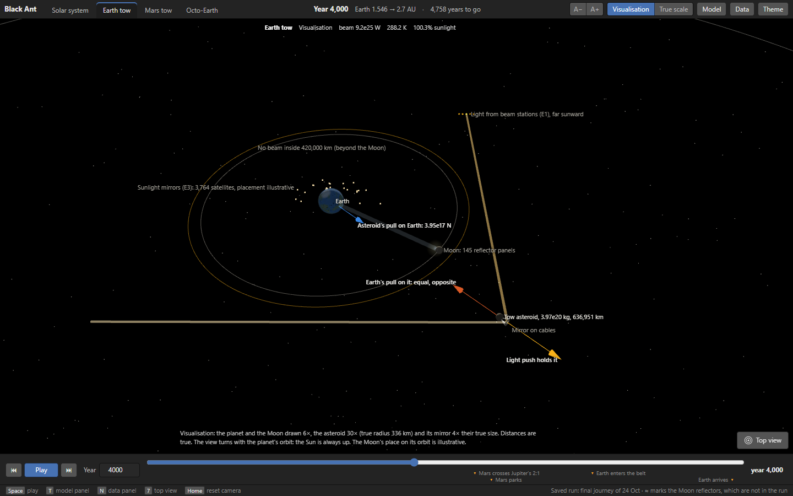
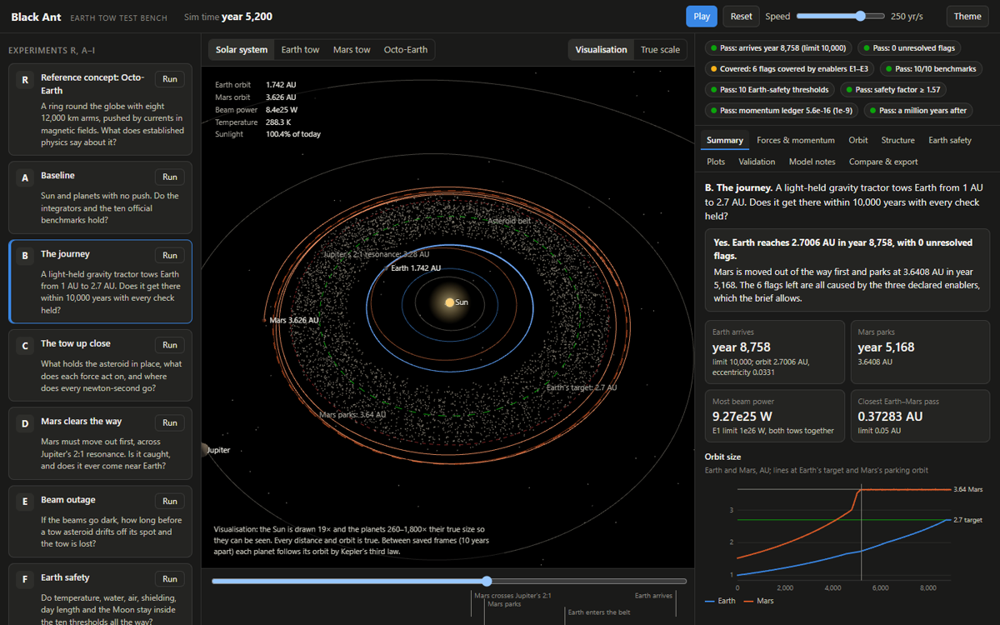

# Black Ant: Towing Earth to 2.7 AU

Technical report, TransfiNITTe 2026, team Black Ant · 24 October 2026

*A copy of the shared report document, kept in the repository so everyone can read it. The figures are from the
3D test bench (`viewer/`).*

## Summary

Earth reaches 2.7006 AU in year 8,758 of the 10,000 allowed, pulled by the gravity of a 3.97 × 10^20 kg asteroid that a beam of light holds in place 637,100 km away. Nothing touches Earth: the asteroid's pull is a real outside force, and every push in the system is booked with its partner.

Every winning condition holds in our simulation. There are 0 unresolved flags; the 6 flags left are all caused by our three declared enablers. All ten official benchmarks pass, the lowest structural safety factor is 1.57, and the ten Earth-safety thresholds hold at every 100-day check. The momentum ledger closes to 5.6 × 10^-16 of the applied impulse (limit 10^-9).

Mars is moved first, to 3.64 AU, so the two planets never meet: their closest pass is 0.37 AU. A million years after arrival, run on with no tows, the new orbits stay put and nothing is thrown out.

## The problem and how it is judged

The brief from Black Ant Robotics asks for a simulation of a machine that moves Earth from 1 AU to about 2.7 AU, near the asteroid belt, without harming the planet or life on it. Teams may simulate the reference concept (Octo-Earth), change it, or propose another concept; we propose a gravity tractor. Teams may declare up to three hypothetical enablers; flags caused only by them are allowed.

| Winning condition | Our result |
| --- | --- |
| Earth reaches the target orbit within 10,000 years | Year 8,758, at 2.7006 AU (eccentricity 0.033) |
| Every Earth-safety threshold holds for the whole run | All ten held at every 100-day check |
| Every structural safety factor at least 1.5 | Lowest 1.57, at the full E1 power cap |
| Every applicable benchmark passes | 10 of 10 official benchmarks |
| Every force booked with its reaction; energy and momentum conserved | Ledger closes to 5.6 × 10^-16 and 5.5 × 10^-22 (limit 10^-9); energy gap at most 6.9 × 10^-7 of the total |
| No unresolved flags | 0 unresolved; 6 caused by enablers E1 to E3 |

The ten Earth-safety thresholds are those of the company's reference demo; the benchmarks, the enabler rules and the 1.5 safety factor come from the participant guide.

## Why not Octo-Earth

Octo-Earth cannot move Earth, and its arms cannot hold themselves up. We audited it with the same physics as our own machine, at the demo's default arm: eight arms, each 12,000 km long, a 200 km tube with 2 km walls, carrying 1 MA with its return conductor 50 km away.



**No net push.** Earth's magnetic field comes from currents in Earth's own core, modelled as a loop with Earth's dipole moment (8.0 × 10^22 A m²). We work out the force of the core's field on the arms (2.27 × 10^6 N) and the force of the arms' field on the core separately, each with Biot–Savart fields and I dl × B. They cancel to 3.7 × 10^-12 of each other (test X8). The arms push only on Earth itself, and a force inside Earth plus machine cannot move them.

- In the demo's uniform 0.5 nT outside field, closed arm circuits feel 10^-11 N against an I L B of 6,000 N: nothing.
- Arms with no return path seem to push, but their charge would have nowhere to go. Even in Earth's full field they would give at most 3 × 10^9 N, so the trip would take about 10^12 years.

**The arms cannot stand.** At a safety factor of 1.5, with the demo's tube:

| Material | Longest standing arm | Buckles under its own weight past | Longest arm held level |
| --- | --- | --- | --- |
| Structural steel S355 | 3 km | 471 km | 17 km |
| Maraging steel 300 | 17 km | 453 km | 41 km |
| CFRP, unidirectional | 86 km | 691 km | 91 km |
| Carbon nanotube, ideal (hypothetical) | 6,964 km | 1,444 km | 568 km |
| Graphene, ideal (hypothetical) | 10,454 km | 1,200 km | 618 km |

A standing 12,000 km arm puts 315 GPa on its base in steel, which yields at 0.355 GPa. Even in ideal nanotube (63 GPa, the strongest single tube ever measured) it reaches only a safety factor of 1.2, and the column buckles (Greenhill's limit) past 1,450 km. Titanium, aluminium and aramid fall between steel and CFRP. This is why we move Earth with an asteroid's gravity instead: the asteroid is outside Earth, and nothing touches the planet.

## The machine: a gravity tractor held by light

A 3.97 × 10^20 kg asteroid (336 km in radius at 2,500 kg/m³) sits 637,100 km from Earth, at 45° between straight ahead along Earth's orbit and straight out from the Sun. Its gravity pulls Earth with 3.95 × 10^17 N, an acceleration of 6.53 × 10^-8 m/s². Earth's orbit widens a little on every lap.



Earth feels only the asteroid's pull. The asteroid feels Earth's equal pull back, balanced by the light push on its mirror, whose partners are the stations' recoil and the light that leaves.

**The beam.** Earth pulls the asteroid back with the same force, so a mirror tied to the asteroid by cables is pushed by focused light from stations far on the Sun's side. Light arriving along *in* and leaving along *out* pushes with (P/c)(in − out). The 45° spot gives the most pull along the orbit per watt, because light can only push. No beam may pass within 420,000 km of Earth, beyond the Moon's farthest point; light may arrive up to 30° off the Sun line to keep clear. The closest any beam came was 448,909 km. The Earth tow used 4.7 to 8.9 × 10^25 W.

**The controller.** Each step it asks for the force that keeps the asteroid on its spot: what the spot's motion needs, minus the gravity the asteroid already feels, plus a correction with a 10-day response. Checks every 100 days confirm the correction beats the planet's pull gradient (2GM/d³) at least threefold and that the 1-day step resolves it. The asteroid never strayed more than 2,715 km (0.4%) from its spot.

**Mars moves first.** Mars's orbit (1.52 AU) lies across Earth's path, so a second tow, a 1.56 × 10^20 kg asteroid 400,000 km from Mars, gives Mars the same acceleration and parks it at 3.64 AU in year 5,168. That orbit sits between the strong resonances with Jupiter and with Earth. Crossing Jupiter's 2:1 resonance (3.28 AU) at the normal pull, Mars was caught in 6 of 8 trials. So between 3.0 and 3.5 AU Mars's asteroid moves in to 200,000 km for 4× the pull (caught in 0 of 8), while Earth's eases out to 850,000 km to keep the total under E1's 10^26 W.

**Arrival trim.** From 2.0 AU the tow varies its pull by up to 40% around each lap and rides up to 20° above or below Earth's orbit plane (Gauss's equations). Earth arrives on the eccentricity and plane that Jupiter forces at 2.7 AU (about 0.030), so it does not wobble afterwards: the free eccentricity left is 0.0023.

**Sunlight mirrors.** Mirrors in space, built in 25-year batches, add the sunlight Earth loses as it moves out: up to 8.5 × 10^8 km² at 2.7 AU. Earth gets 0.995 to 1.010 of today's sunlight the whole way. After arrival each tow asteroid is sent away, and the momentum it carries off is booked.

## Declared enablers

We declare three of the three allowed. Each has a hard limit in the configuration, and each flag it causes names it.

| Enabler | What it provides | Limit | Most the run used | Flags it covers |
| --- | --- | --- | --- | --- |
| E1 Power source | Focused light from many independent stations; their recoil and the bounced light are booked. Also nudges dangerous asteroids aside | 10^26 W | 9.27 × 10^25 W | Beam power far above humanity's; closest big asteroid (Vesta, 0.018 AU, nudged with 3 minutes of beam); belt impact rates, crossing and parked |
| E2 Super-mirror material | Absorbs 10^-7 of the light; 100 GPa strength; up to 1,500 K | as stated | Mirror at 1,466 K and cables at safety factor 1.57, both at the power cap | Tow mirrors and cables |
| E3 Planet-scale space manufacturing | Places the tow asteroids; builds the tow and sunlight mirrors | 10^9 km² of mirrors | 5.5 × 10^20 kg of asteroids; 8.5 × 10^8 km² of mirrors | Asteroids and mirrors in place |

After arrival, two more flags arise over a million years, both covered: 45 big-asteroid passes near Earth, each nudged by E1 with at most 0.6 hours of a 10^25 W beam 50 years ahead; and a wider swing of Earth's axial tilt, for which E3's mirrors re-aim 1.4% of Earth's sunlight to keep today's seasons.

## Models and equations

Every body pulls every other: the Sun, Venus to Neptune on their real J2000 orbits (JPL), Ceres, Pallas, Vesta and Hygiea (JPL Horizons), and both tow asteroids. Each pair's forces are computed once and applied as exact negatives.

```latex
\ddot{\mathbf r}_i = \sum_{j \ne i} \frac{G m_j (\mathbf r_j - \mathbf r_i)}{|\mathbf r_j - \mathbf r_i|^3} + \frac{\mathbf F_i^{\text{beam}}}{m_i}
```

- **Integrators.** Leapfrog (kick, drift, kick) with 1-day steps for the journey; Yoshida fourth order for the benchmarks; REBOUND's MERCURIUS with 5-day steps for the million-year runs. Halving the step to 0.5 days moves Earth's arrival from year 8,758 to 8,730 (0.3%) with the same orbit (2.70 AU, eccentricity 0.033, tilt 1.29°); Mars parks in 5,170 against 5,168, there are 0 unresolved flags and the ledger closes to 2.3 × 10^-16. Only the big asteroids' closest passes move (Vesta 0.037 AU against 0.018), because they depend on where each asteroid is as Earth goes by; that is why E1 nudges them instead of relying on the miss distance.
- **Light pressure.** A mirror turning light from direction *in* to *out* feels the force below; the power for a wanted force F follows from it.

```latex
\mathbf F = \frac{P}{c}(\hat{\mathbf n}_{in} - \hat{\mathbf n}_{out}), \qquad P = \frac{|\mathbf F|^2 c}{2\, \hat{\mathbf n}_{in} \cdot \mathbf F}
```

- **Orbit growth (Gauss).** A push f along the velocity v grows the orbit as below; benchmark 8 checks the integrator against it.

```latex
\frac{da}{dt} = \frac{2a^2}{\mu}\, \mathbf v \cdot \mathbf f
```

- **Climate.** A zero-dimensional energy balance, with an albedo that rises from 0.30 to 0.62 as the surface freezes between 280 and 250 K, and an emissivity set so today's Earth sits at 288 K. A latitude profile gives the share of the surface with liquid water (82% today). Without mirrors it gives 150 K and no liquid water at 2.7 AU, as the company's demo does.

```latex
\frac{S}{4}\,(1 - \alpha(T)) = \varepsilon \sigma T^4
```

- **Atmosphere, shielding, Moon.** Nitrogen's Jeans parameter λ = GMm/(kTR) with the exosphere temperature scaled by sunlight; the magnetopause from solar-wind pressure (10 Earth radii today, growing as a^(1/3)); the Moon against Earth's Hill radius a (M/3M☉)^(1/3).
- **Day length.** The tow asteroid's tide on Earth: torque (3/2)(k₂/Q) G m² R⁵/d⁶ on Earth's moment of inertia, added up over the journey.
- **Axial tilt.** Earth's spin axis precesses about its moving orbit pole, ds/dt = α (s · n)(s × n), with α from the IAU 2006 precession rate.
- **Momentum ledger.** Every push is added with an error-free sum (two-sum compensation), so momentum is conserved to the precision of the arithmetic itself.

## Validation

All ten official benchmarks (participant guide, section 6) pass. A test reruns them with changed inputs (benchmark 4 holds from e = 0 to 0.9, its steps scaled to the pericentre). Each runs with inputs a judge can change: `uv run python -m sim.benchmarks 4 --set e=0.5`.

| # | Benchmark | Measured | Expected (tolerance) |
| --- | --- | --- | --- |
| 1 | Wire in a field, I L × B summed over 1,000 pieces | (0, 0, 10) N | (0, 0, 10) N (10^-9) |
| 2 | Closed loop in a uniform field | 4.3 × 10^-16 of I L B | 0 (10^-9 of I L B) |
| 3 | Long straight wire, field at 1 m (Biot–Savart) | 2.00000 × 10^-4 T | μ₀I/2πr (10^-6) |
| 4 | Kepler orbit, e = 0.3, 10 periods | back within 1.8 × 10^-8 a; energy 1.1 × 10^-10 | 10^-6 a; 10^-9 |
| 5 | Sun, Mercury to Neptune, 5 years, no push | energy error 8.9 × 10^-11 | 10^-9 |
| 6 | Earth–Moon barycentre's year | 365.260 days | 365.256 (0.1 day) |
| 7 | Hohmann transfer, Earth to Mars | 2.946 and 2.650 km/s; 258.9 days | 2.94, 2.65 km/s; 259 days (0.02 km/s; 2 days) |
| 8 | Push along the velocity: orbit growth | 3,169.7 km | 3,170.1 km from Gauss (1%) |
| 9 | Cantilever under its own weight | root moment and tip deflection both within 10^-9 | qL²/2, qL⁴/8EI (1%) |
| 10 | Earth's equilibrium temperature | 254.0 K | 254 K (2 K) |

Our own checks add what the benchmarks leave out: Kepler's third law (X1), energy over 1,000 years (X2), the momentum ledger in the guide's form with a push on (X3), a Hohmann transfer flown (X4), a steady push's arrival time against theory (X5), agreement with REBOUND, an independent code (X6), the asteroid's pull and hold (X7), Octo-Earth's zero net force (X8) and the axial tilt (X9). The quick tests run on every pull request.

## Results of the journey

Earth arrives in year 8,758 at 2.7006 AU, with an eccentricity of 0.033 and a tilt of 1.29° to today's ecliptic, moving at 17.6 km/s. Mars is parked at 3.641 AU in year 5,168, so it is out of Earth's way 3,600 years before Earth gets there.



Earth's orbit grows slowly at first and faster later: the same pull adds more to a wider orbit. Mars's climb steepens near 3.3 AU, where its tow sprints across Jupiter's 2:1 resonance. The two planets come closest at the very start (0.373 AU, an ordinary Mars opposition), never later. The beams of both tows together peaked at 9.27 × 10^25 W. Two hundred years after arrival, with the tows gone, Earth sits at 2.699 AU with an eccentricity of 0.034.

## Earth safety

All ten thresholds hold at every 100-day check of the journey. Mirrors in space keep Earth's sunlight between 0.995 and 1.010 of today's, so the climate stays where it is; without them the same model gives 150 K and no liquid water at 2.7 AU.

| Threshold | Worst over the journey | Limit |
| --- | --- | --- |
| Global mean temperature | 287.8 to 288.8 K | 263 to 308 K |
| Surface with liquid water | at least 82% | at least 30% |
| Absorbed sunlight (runaway greenhouse) | at most 240.9 W/m² | under 282 W/m² |
| Surface pressure | 101.3 kPa | at least 50 kPa |
| Nitrogen kept (Jeans λ) | at least 194 | over 30 |
| Magnetopause distance | at least 10.0 Earth radii | at least 3 |
| Change in length of day | about 2 × 10^-7 s | at most 1 s |
| Moon's distance over Earth's Hill radius | at most 0.256 | under 0.49 |
| Tow thrust over Earth's pull on the Moon | at most 0.0020 | under 0.01 |

The Moon grows safer as Earth moves out: Earth's Hill sphere widens with distance from the Sun, so the Moon's share falls from 0.256 to 0.095. The magnetopause widens too, from 10 to 13.9 Earth radii, as the solar wind thins. The mirrors reach 8.5 × 10^8 km² at 2.7 AU, under E3's limit of 10^9 km².

## Structures

Every structure keeps a safety factor of at least 1.57, above the 1.5 required. Each is sized for the most a beam can ever push, 2P/c (a perfect mirror sending light straight back) at its tow's power cap, so recovering after an outage is covered too. The checks run every 100 days during the journey.

| Check, at the power cap | Earth tow (10^26 W) | Mars tow (4 × 10^25 W) | Limit |
| --- | --- | --- | --- |
| Cable safety factor (E2 material, 100 GPa) | 1.57 | 1.57 | at least 1.5 |
| Anchor safety factor (load spread into rock of 0.1 GPa) | 1.57 | 1.57 | at least 1.5 |
| Tow mirror temperature (absorbs 10^-7, radiates from both faces) | 1,466 K | 1,463 K | at most 1,500 K |
| Asteroid body safety factor (the planet's uneven pull across it) | 120 | 152 | at least 1.5 |

At the most power the journey actually used, the cables and anchors have a safety factor of 1.77 and the mirrors run at about 1,420 K. The design sizes are cables of 10.5 and 4.2 km² cross-section, anchors of 10,500 and 4,200 km², and mirrors of 2,600 and 1,650 km radius.

## Conservation and the momentum ledger

Momentum is conserved to the precision of the arithmetic itself, far inside the guide's limit. The only outside forces in the run are the beams' pushes on the two tow asteroids: the applied impulse. Their partners are the beam stations, which recoil as they fire, and the light, which carries momentum away after bouncing. Gravity between bodies is applied in exactly opposite pairs, and asteroids sent away at the end of their tows take their momentum with them.

| The guide's check | Worst during the run | At the end | Limit |
| --- | --- | --- | --- |
| Integrator is honest: the bodies' momentum change against the applied impulse | 5.5 × 10^-22 | 1.5 × 10^-22 | 10^-9 of the applied impulse |
| Nothing from nothing: the applied impulse plus its partners | 5.6 × 10^-16 | 3.6 × 10^-17 | 10^-9 of the applied impulse |

The applied impulse over the journey is 8.78 × 10^26 kg m/s. The beams did 1.7969 × 10^33 J of work, and the bodies gained 1.7970 × 10^33 J, counting what left with the asteroids: they match to 0.007%. The worst gap between work and energy gained during the run was 6.9 × 10^-7 of the system's total energy. With no push, the real solar system keeps its energy to 4.0 × 10^-9 over a million years, and benchmark 5 to 8.9 × 10^-11 over five.

## Hazards and stability

**Crossing the asteroid belt.** Without help, Earth would meet a 1 km asteroid about once every 127 years while crossing the belt and once every 87 years parked at 2.7 AU, against once per 500,000 years today. We tracked 1,000 real belt orbits (JPL Small-Body Database) for 2,958 years and scaled their 1,325 close passes to the belt's 1.2 million asteroids over 1 km. E1 handles each: found 10 years ahead, it is nudged 5 cm/s aside by a 1.1 × 10^14 W beam for one day, about a trillionth of the tow beams' power. Of the big asteroids, Vesta comes closest (0.018 AU), twice, and is nudged with 3 minutes of beam each time.

**Beam outages.** The beams come from many independent stations, so losing all of them at once is the worst case. Each case below is a full run with the beams cut for longer and longer, until the asteroid can no longer be caught.

| Case | Longest outage with the asteroid kept |
| --- | --- |
| Earth tow, all stations off | 15 hours |
| Earth tow, half the stations off | 1.25 days |
| Earth tow, a quarter off | 2.8 days |
| Mars tow, all stations off | 4.75 days |
| Mars tow, half or a quarter off | more than 8 days (the longest tried) |
| Mars tow during its sprint, all off | 10.5 hours |
| Earth tow during Mars's sprint, all off | 3.4 days |

**A million years after arrival.** With the tows gone, we ran the moved solar system for a million years (REBOUND, MERCURIUS) beside the real one. Nothing was thrown out, there were 0 unresolved flags, and two chaos copies, started with tiny changes, agree.

| | Moved solar system | Real solar system |
| --- | --- | --- |
| Earth's orbit size | 2.698 to 2.702 AU | 0.99998 to 1.00004 AU |
| Earth's eccentricity, highest | 0.060 | 0.051 |
| Earth's axial tilt | 21.7° to 26.1° | 22.2° to 24.4° |
| Mars's orbit size | 3.614 to 3.655 AU | 1.5236 to 1.5239 AU |

Mars's orbit never comes within 0.36 AU of Earth's. Earth's tilt swings twice as wide as today's, because at 2.7 AU its spin precession runs close to a slow mode of the planets' orbits; the sunlight mirrors (E3) re-aim 1.4% of Earth's sunlight to keep today's seasons. 45 big-asteroid passes come near Earth in the million years; E1 nudges each, 50 years ahead, with at most 0.6 hours of a 10^25 W beam.

## Limits of the model

The model answers whether the physics closes; it does not design the hardware. What it leaves out, and why we think the answer stands:

- **How the machine is built.** Beam stations, mirrors and the placing of the asteroids are what E1, E2 and E3 declare. The simulation books their forces, recoil and limits, not their engineering.
- **Climate in one dimension.** A global energy balance with ice-albedo feedback and a latitude profile for liquid water: no weather, oceans, carbon cycle or biology. The mirrors hold sunlight within 1% of today's, so Earth stays near the state the model is calibrated on.
- **Separate runs for the Moon and Earth's spin.** The journey carries the Earth–Moon pair as one body; the Moon's orbit (`sim/scenarios/moon.py`) and the axial tilt (`sim/spin.py`) are followed in their own runs and checked against the journey's orbits.
- **Planets and four big asteroids, not Mercury.** Mercury's pull on Earth is tiny and its 88-day orbit would need far shorter steps; it joins benchmark 5. Smaller asteroids are a 1,000-orbit sample, scaled.
- **Safety thresholds.** We adopted the ten of the company's reference demo. If the rulebook's appendix differs, its numbers go into the configuration and the run is repeated; nothing else changes.

Next we would add the Moon as its own body inside the journey, a latitude-resolved climate, and a sensitivity sweep of tow mass and distance.

## Reproduce it

Everything in this report comes from the code and results in this repository. Every setting and limit lives in `config.yaml` with its source; change a number and re-run.

```bash
uv sync
uv run python -m sim.benchmarks                  # the ten official benchmarks, about 12 seconds
uv run pytest -m "not slow"                      # quick tests, about a minute
uv run python -m sim.scenarios.tow --out results # the full journey with every check, about an hour
uv run python -m sim.scenarios.longterm --only moved --state results/end_state.json
uv run python -m sim.scenarios.octo              # the Octo-Earth audit, 10 seconds
```

The 3D test bench replays these runs in the browser, with the solar system, both tows up close, Octo-Earth, ten experiments and every check beside them: [ashish000011.github.io/black-ant](https://ashish000011.github.io/black-ant/). The conservation and momentum record is `docs/momentum-record.md`; every risk we looked for and its counter is in `docs/risk-register.md`.
